

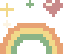 ${\color{#c05b76}\huge \textbf{cute readme}}$ 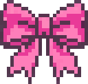

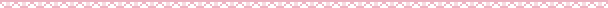

[English](README.md) | **한국어** | [简体中文](README.zh-CN.md)

make your GitHub profile a tiny pixel home

깃허브 프로필용 픽셀 도구 모음입니다. 미니룸 에디터, 블록으로 쌓는 리드미 빌더, 링크 뱃지, 저장소 카드, 기여자 그래프가 들어 있습니다.


[빌더](https://kimjungminn24.github.io/cute-readme/)에서 `+ miniroom` 블록을 놓고 `Make a room` 을 누르세요. `Items` 탭에서 가구를 골라 바닥에 놓고, 색을 고르고, 말풍선을 답니다. `room.svg` 로 나옵니다.

## 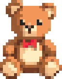 Assemble your README

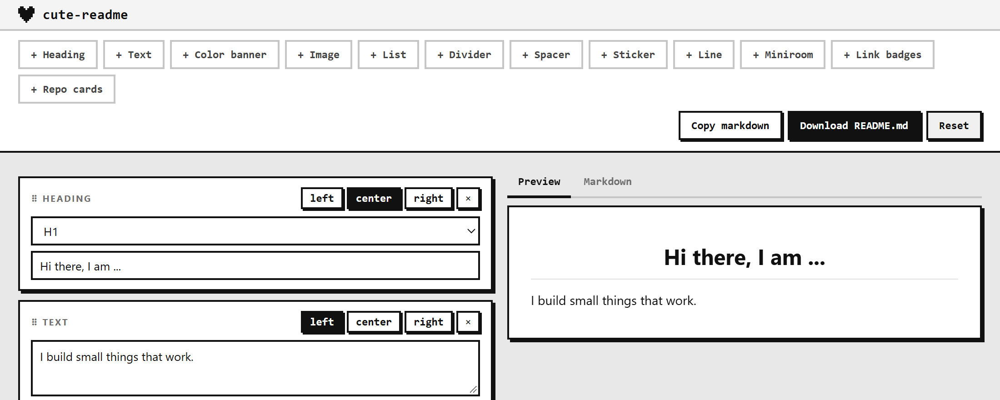

블록을 쌓습니다. 제목, 글, 그림, 스티커, 방, 뱃지, 카드. 끌어서 순서를 바꾸고, 옆에 떨어뜨리면 단이 됩니다. `Download README.md` 를 누르면 그림까지 zip 으로 받습니다.

## 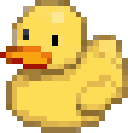 Add link badges

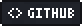  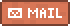  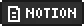 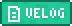  

`+ link badges` 블록을 놓고 프리셋을 고르거나 이름과 주소를 직접 적습니다.

## 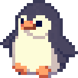 Add repository cards

<a href="https://github.com/kimjungminn24/cute-readme">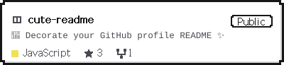</a>

`+ repo cards` 블록을 놓고 `owner/repo` 를 적습니다. 위 카드는 `pixel` 테마입니다.

## 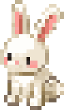 CONTRIBUTORS


## 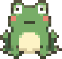 When something does not work

- 그림이 안 보이면: `./room.svg` 처럼 상대 경로인지, 파일을 커밋했는지 봅니다.
- 눌러도 안 열리면: 그림 전체를 `<a>` 로 감쌌는지 봅니다. SVG 안의 `<a>` 는 무시됩니다.
- 안 움직이면: 브라우저나 OS 에서 동작 줄이기가 켜져 있는지 봅니다.

## 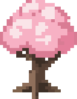 License

MIT ([LICENSE](LICENSE)). [assets/galmuri11.dot](assets/galmuri11.dot) 만 [Galmuri11](https://github.com/quiple/galmuri) 글꼴에서 왔고 SIL OFL 1.1 을 따릅니다. 이 도구가 만든 SVG 에는 아무 제약이 없습니다.

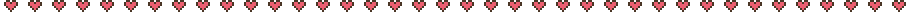

