<div align="center">

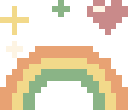 ${\color{#c05b76}\huge \textbf{cute readme}}$ 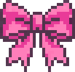


**English** | [한국어](README.ko.md) | [简体中文](README.zh-CN.md)

make your GitHub profile a tiny pixel home

A pixel toolbox for your GitHub profile: a mini-room editor, a block README builder, link badges, repo cards and a contributors graph.


Drop a `+ miniroom` block in the [builder](https://kimjungminn24.github.io/cute-readme/) and hit `Make a room`. Place furniture from the `Items` tab, pick colours, add a speech bubble. It comes out as `room.svg`.

`Contribution Grass` lays your GitHub graph on the floor. To keep it up to date, copy [templates/grass.yml](templates/grass.yml) to `.github/workflows/grass.yml`; it redraws the grass in `room.svg` once a day.

## Assemble your README

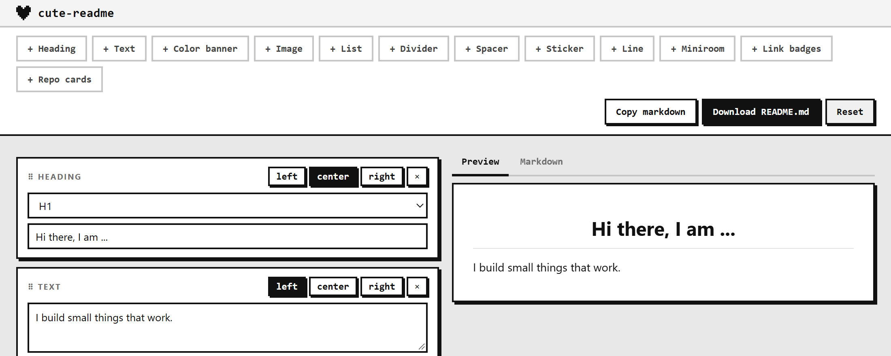

Stack blocks: headings, text, images, stickers, rooms, badges, cards. Drag to reorder, drop one beside another for columns. `Download README.md` hands you a zip with the images in it.

## Add link badges

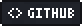  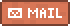  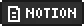   

Drop a `+ link badges` block, pick a preset or type your own label and URL.

## Add repository cards

<a href="https://github.com/kimjungminn24/cute-readme">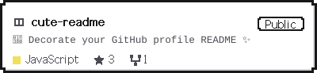</a>

Drop a `+ repo cards` block and enter `owner/repo`. The card above is the `pixel` theme.

## Add an about me card

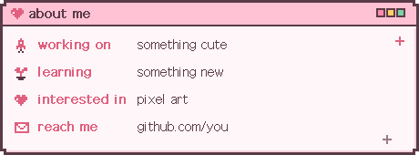

Drop a `+ about me` block and fill in a few lines: working on, learning, interested in, or anything else. Each line gets a pixel icon. Themes: `pixel`, `candy`, `soda`, `matcha`, `night`, plus plain `light` and `dark`.

## Add a music card

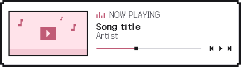 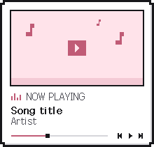

Drop a `+ music` block and paste a YouTube link. `Load` fills in the title and the video thumbnail. If the thumbnail cannot be fetched, the card uses a pixel cover instead. Pick `wide` or `square`. The card links to the video, so there is nothing to keep running.

## CONTRIBUTORS


## Guestbook

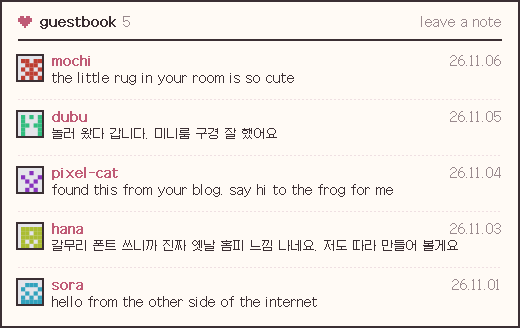

Visitors sign by commenting on a GitHub Discussion, and their notes show up in your README with their avatar and name.

> **Turn on Discussions first.** They are off by default, and the workflow cannot find the guestbook without them.

1. Turn on Discussions in Settings > General > Features.
2. Start a discussion with `Guestbook` in its title. The Announcements category works well: only you can start posts there, and anyone can comment.
3. Copy [templates/guestbook.yml](templates/guestbook.yml) to `.github/workflows/guestbook.yml`. It redraws `guestbook.svg` whenever someone comments.

Link the image to the discussion so visitors know where to write:

```html
<a href="https://github.com/YOU/YOU/discussions/1"></a>
```

To take a note down, hide the comment in the discussion. Hidden comments drop out on the next run.

GitHub subscribes everyone who comments to the thread, so earlier visitors get a notification for each new note. Nobody else can turn that off for them, so it helps to say how in the discussion itself:

```md
Commenting subscribes you to this thread. Click **Unsubscribe** on the right to stop notifications.
```

## When something does not work

- The image does not show up: use a relative path like `./room.svg`, and commit the file.
- Clicking does nothing: wrap the whole image in an `<a>`. An `<a>` inside the SVG is ignored.
- Nothing animates: reduce motion is on in the browser or the OS.

## Docs

[Reference](docs/reference.md) for the room JSON, catalog and every option · [How it works](docs/how-it-works.md) · [Minimi](docs/minimi.md)

## License

MIT ([LICENSE](LICENSE)). [assets/galmuri11.dot](assets/galmuri11.dot) comes from the [Galmuri11](https://github.com/quiple/galmuri) font and is under SIL OFL 1.1. The SVGs this tool makes carry no restrictions.

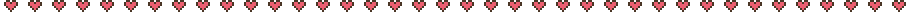

</div>
