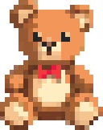
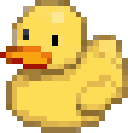
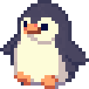
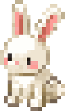
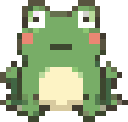
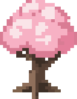

 ${\color{#c05b76}\huge \textbf{cute readme}}$ 

**English** | [한국어](README.ko.md) | [简体中文](README.zh-CN.md)

make your GitHub profile a tiny pixel home

A pixel toolbox for your GitHub profile: a mini-room editor, a block README builder, link badges, repo cards and a contributors graph.

Drop a `+ miniroom` block in the [builder](https://kimjungminn24.github.io/cute-readme/) and hit `Make a room`. Place furniture from the `Items` tab, pick colours, add a speech bubble. It comes out as `room.svg`.

##  Assemble your README

Stack blocks: headings, text, images, stickers, rooms, badges, cards. Drag to reorder, drop one beside another for columns. `Download README.md` hands you a zip with the images in it.

##  Add link badges

       

Drop a `+ link badges` block, pick a preset or type your own label and URL.

##  Add repository cards

Drop a `+ repo cards` block and enter `owner/repo`. The card above is the `pixel` theme.

##  CONTRIBUTORS

##  When something does not work

- The image does not show up: use a relative path like `./room.svg`, and commit the file.
- Clicking does nothing: wrap the whole image in an `<a>`. An `<a>` inside the SVG is ignored.
- Nothing animates: reduce motion is on in the browser or the OS.

##  License

MIT ([LICENSE](LICENSE)). [assets/galmuri11.dot](assets/galmuri11.dot) comes from the [Galmuri11](https://github.com/quiple/galmuri) font and is under SIL OFL 1.1. The SVGs this tool makes carry no restrictions.

