<div align="center">

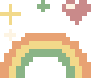 ${\color{#c05b76}\huge \textbf{cute readme}}$ 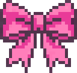


[English](README.md) | [한국어](README.ko.md) | **简体中文**

make your GitHub profile a tiny pixel home

给 GitHub 个人主页用的像素工具箱：小房间编辑器、按块拼装的 README 生成器、链接徽章、仓库卡片和贡献者图。


在[生成器](https://kimjungminn24.github.io/cute-readme/)里放一个 `+ miniroom` 块，点 `Make a room`。在 `Items` 标签里选家具放到地板上，挑颜色，加对话气泡。导出为 `room.svg`。

`Contribution Grass` 把你的 GitHub 贡献图铺在地板上。把 [templates/grass.yml](templates/grass.yml) 复制到 `.github/workflows/grass.yml`，它每天会把 `room.svg` 里的草地重画成最新的。

## Assemble your README

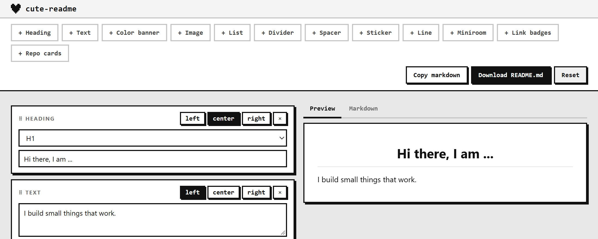

把块堆起来：标题、文字、图片、贴纸、房间、徽章、仓库卡片。拖动可以换顺序，放到另一个块旁边就成了分栏。点 `Download README.md` 会连图片一起打包成 zip。

## Add link badges

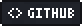    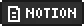   

放一个 `+ link badges` 块，选预设或者自己填名字和网址。

## Add repository cards

<a href="https://github.com/kimjungminn24/cute-readme">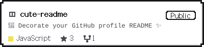</a>

放一个 `+ repo cards` 块，填 `owner/repo`。上面这张是 `pixel` 主题。

## Add a music card

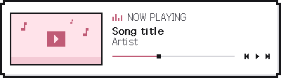 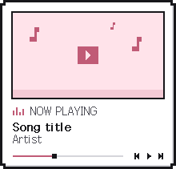

放一个 `+ music` 块，粘贴 YouTube 链接。点 `Load` 会填入标题和视频缩略图；取不到缩略图时会改用像素封面。可以选 `wide` 或 `square`。卡片链接到视频，不需要任何工作流。

## CONTRIBUTORS


## Guestbook

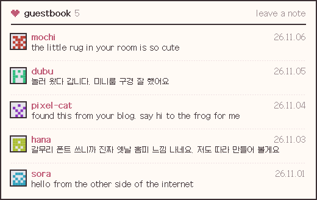

访客在 GitHub Discussion 里留言，留言会连同头像和名字一起出现在你的 README 留言簿里。

> **请先打开 Discussions。** 它默认是关闭的，关闭时工作流找不到留言簿。

1. 在 Settings > General > Features 里打开 Discussions。
2. 新建一个标题里带 `Guestbook` 的讨论。推荐用 Announcements 分类：只有你能发帖，所有人都能评论。
3. 把 [templates/guestbook.yml](templates/guestbook.yml) 复制到 `.github/workflows/guestbook.yml`。每次有人留言，它都会重画 `guestbook.svg`。

把图片链接到这个讨论，访客就知道在哪里留言：

```html
<a href="https://github.com/YOU/YOU/discussions/1"></a>
```

想撤下某条留言，在讨论里隐藏该评论即可，下次运行时它就会消失。

GitHub 会让每个留言的人自动订阅这个讨论，所以之前的访客每来一条新留言都会收到通知。别人无法替他们关闭，所以最好在讨论正文里写上关闭方法：

```md
留言后你会订阅这个讨论。不想收到通知的话，点右侧的 **Unsubscribe**。
```

## When something does not work

- 图片不显示：确认路径是 `./room.svg` 这样的相对路径，并且文件已经提交。
- 点了没反应：确认整张图被 `<a>` 包住。SVG 内部的 `<a>` 会被忽略。
- 没有动画：确认浏览器或系统没有开启减少动态效果。

## Docs

房间 JSON、素材目录和全部选项见[参考](docs/reference.zh-CN.md) · [是怎么做的](docs/how-it-works.zh-CN.md) · [迷你小人](docs/minimi.md)

## License

MIT ([LICENSE](LICENSE))。只有 [assets/galmuri11.dot](assets/galmuri11.dot) 来自 [Galmuri11](https://github.com/quiple/galmuri) 字体，遵循 SIL OFL 1.1。本工具生成的 SVG 没有任何限制。

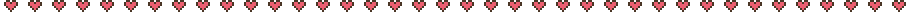

</div>
